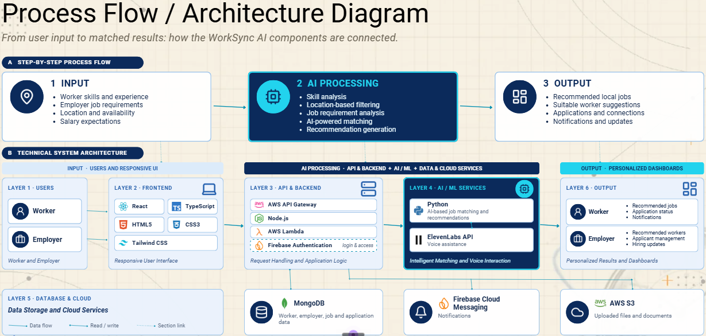
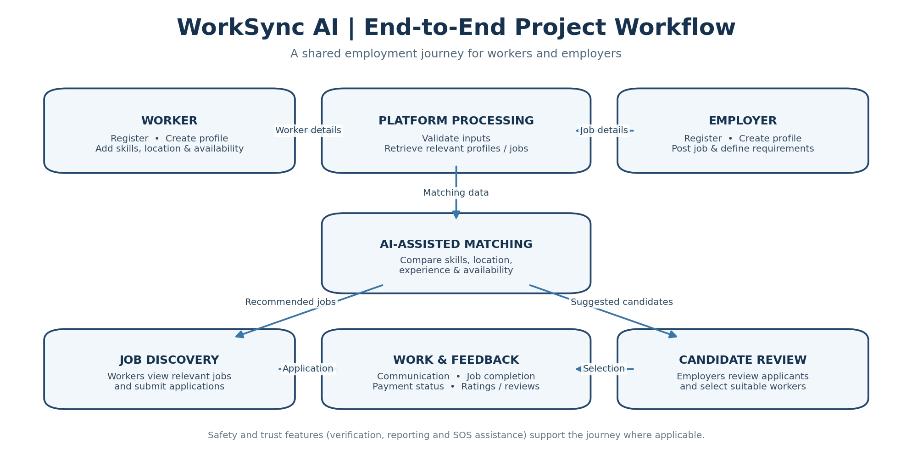

# WorkSync AI
### AI-Powered Hyper-Local Job Matching Platform for Informal and Semi-Skilled Workers

**Track:** Track 4 – UnlockED  
**Problem Statement:** PS 3 – Hyper-Local Job Matching for Informal & Semi-Skilled Workers

## About the Project

WorkSync AI is a proposed AI-powered employment platform designed to connect informal and semi-skilled workers with nearby employment opportunities.

The platform aims to simplify job discovery, improve employment accessibility, strengthen trust between workers and employers, and promote safer working environments.

## Problem Statement

Informal and semi-skilled workers often face difficulties finding reliable local employment due to limited access to digital job platforms, lack of verified opportunities, communication barriers, and limited employment networks.

## Proposed Solution

WorkSync AI provides a centralized platform where workers can discover nearby jobs and employers can find suitable workers through intelligent job matching.

The platform combines employment intelligence, worker management, trust mechanisms, and safety features.

## Key Features

- AI-powered hyper-local job matching
- Worker and employer registration
- Employer job posting and worker applications
- Voice-based assistance
- Location-based job discovery
- Worker and employer ratings and reviews
- Worker verification and trust system
- SOS Emergency Button
- Worker productivity and employment management
- Employment notifications

## Technology Stack

**Frontend:** React, TypeScript, HTML5, CSS3, Tailwind CSS

**Backend:** Node.js, Python

**Database:** Firebase / MongoDB (planned integration)

**AI & Intelligence:** AI-powered matching and recommendation capabilities

**APIs:** Location and mapping services, notification services, and other relevant integrations

## Project Architecture

The proposed architecture consists of:

1. Frontend – Worker and employer interfaces.
2. Backend – Application logic and request handling.
3. Database – User profiles, jobs, applications, and ratings.
4. AI Layer – Intelligent job matching and recommendations.
5. External APIs – Location, mapping, and notification services.

## Target Users

- Informal workers
- Semi-skilled workers
- Local employers
- Small businesses and service providers

## Expected Impact

- Improved access to local employment.
- Reduced difficulty in finding suitable workers.
- Better employment transparency.
- Improved trust and safety.
- Increased digital accessibility for workers.

## Project Status

This repository documents the proposed solution, features, technical architecture, and development roadmap for the hackathon Ideathon.

Features and integrations are subject to implementation and testing.

## Team

**Project:** WorkSync AI  
**Track:** UnlockED – Track 4

## System Architecture

## Project Workflow

## Project Documentation

- [Problem Statement](docs/Problem-Statement.md)
- [Proposed Solution](docs/Proposed-Solution.md)
- [Features](docs/Features.md)
- [System Architecture](docs/System-Architecture.md)
- [Technology Stack](docs/Technology-Stack.md)
- [Workflow](docs/Workflow.md)
- [Safety Framework](docs/Safety-Framework.md)
- [Innovation and Uniqueness](docs/Innovation-and-Uniqueness.md)
- [Development Roadmap](docs/Development-Roadmap.md)